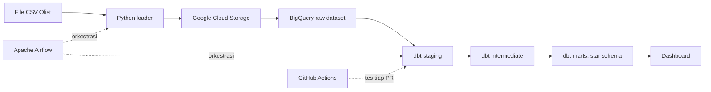

# E-commerce Data Warehouse

Pipeline ELT batch end-to-end yang mengubah data mentah e-commerce menjadi star schema teruji di BigQuery, dengan orkestrasi Apache Airflow dan pemodelan data menggunakan dbt.

**[Lihat dashboard live](https://datastudio.google.com/s/pjhwMohMZ4o)**


## Overview

Project ini memakai [dataset publik Olist](https://www.kaggle.com/datasets/olistbr/brazilian-ecommerce), yaitu data transaksi marketplace Brasil periode 2016–2018. Data tersebar di banyak file CSV, jadi perlu diolah dulu sebelum bisa dianalisis.

Pipeline ini memuat data ke cloud, membersihkan dan memodelkannya, menguji kualitasnya secara otomatis, lalu menyajikannya dalam dashboard.

## Tujuan bisnis

Memberi analis satu sumber data tepercaya untuk penjualan, performa pengiriman, dan kepuasan pelanggan. Pertanyaan seperti "kategori mana yang paling sering terlambat?" bisa dijawab tanpa query manual ke file mentah.

## Temuan utama

- **Keterlambatan berkaitan erat dengan skor review.** Order tepat waktu rata-rata mendapat skor 4,29, sedangkan order terlambat hanya 2,57.
- **8,1% order terkirim terlambat,** sehingga performa pengiriman layak ditelusuri lebih lanjut.
- **Hanya 3,1% pelanggan yang order lebih dari sekali,** jadi retensi pelanggan masih rendah.

## Arsitektur



## Tech stack

| Area | Tools |
|---|---|
| Orkestrasi | Apache Airflow, Docker Compose |
| Penyimpanan | Google Cloud Storage, BigQuery |
| Transformasi | dbt, SQL |
| Data quality | dbt tests, dbt_utils |
| CI | GitHub Actions, DuckDB |
| Dashboard | Data Studio (sebelumnya Looker Studio) |

## Model data

| Tabel | Grain |
|---|---|
| `fct_order_items` | Satu baris per item dalam order |
| `fct_orders` | Satu baris per order |
| `dim_customers` | Satu baris per pelanggan unik |
| `dim_products` | Satu baris per produk |
| `dim_sellers` | Satu baris per penjual |
| `dim_date` | Satu baris per hari |
| `rpt_orders` | Tabel datar untuk dashboard, satu baris per order |
| `rpt_order_items` | Tabel datar untuk dashboard, satu baris per item dalam order |

## Keputusan desain

- **Semua kolom di tabel raw bertipe string.** Tipe data diubah di dbt staging, supaya nilai yang salah terlihat di model, bukan menggagalkan proses load.
- **`dim_customers` memakai `customer_unique_id`.** Sumber data membuat `customer_id` baru untuk setiap order, jadi memakainya akan menghitung pelanggan lama sebagai pelanggan baru.
- **Review diringkas menjadi satu per order** sebelum di-join, karena sebagian order punya beberapa review yang bisa terhitung ganda.
- **Tabel fact dipartisi per bulan dan di-cluster** pada kolom yang sering difilter, supaya data yang dipindai BigQuery lebih sedikit.
- **Tidak memakai service account key.** Pipeline memakai impersonation lewat Application Default Credentials, sehingga tidak ada key jangka panjang yang dibuat.
- **CI berjalan di DuckDB dengan data sampel,** sehingga model dan test diuji di setiap pull request tanpa kredensial atau biaya cloud.

## Cara menjalankan

1. Unduh [dataset Olist](https://www.kaggle.com/datasets/olistbr/brazilian-ecommerce) dan taruh file CSV-nya di folder `data/`.
2. Buat bucket GCS dan service account dengan akses BigQuery dan Storage. Jalankan `gcloud auth application-default login --impersonate-service-account=SERVICE_ACCOUNT_EMAIL`, lalu salin `application_default_credentials.json` ke folder `keys/`.
3. Salin `.env.example` menjadi `.env`, lalu isi nilainya.
4. Jalankan Airflow:

   ```bash
   docker compose up --build -d
   ```

5. Buka http://localhost:8080 (login lokal `admin` / `admin`), lalu aktifkan dan jalankan DAG `olist_warehouse`.

## Pengujian tanpa GCP

```bash
pip install "dbt-core~=1.12.0" dbt-duckdb duckdb
python scripts/load_sample_duckdb.py
cd dbt
dbt deps --profiles-dir .
dbt build --target ci --profiles-dir .
```

## Hasil

Pipeline memuat sekitar 550.000 baris data mentah dari 8 tabel. Semua model dan test dbt berjalan tanpa error, dengan 1 peringatan yang dijelaskan di bagian tantangan.

| Metrik | Nilai |
|---|---|
| Order | 99.441 |
| Item order | 112.650 |
| Pelanggan unik | 96.096 |
| Pelanggan dengan lebih dari satu order | 3,1% |
| Order terlambat | 8,1% |
| Rata-rata skor review, tepat waktu | 4,29 |
| Rata-rata skor review, terlambat | 2,57 |

## Tantangan

- **Pembuatan service account key diblokir** oleh kebijakan organisasi, jadi pipeline beralih ke impersonation tanpa key lewat Application Default Credentials.
- **Total pembayaran tidak selalu sama dengan total order.** Ada 246 order terkirim dengan selisih lebih dari 1 BRL. Ini dilaporkan sebagai peringatan, supaya tetap terlihat tanpa menghentikan pipeline.
