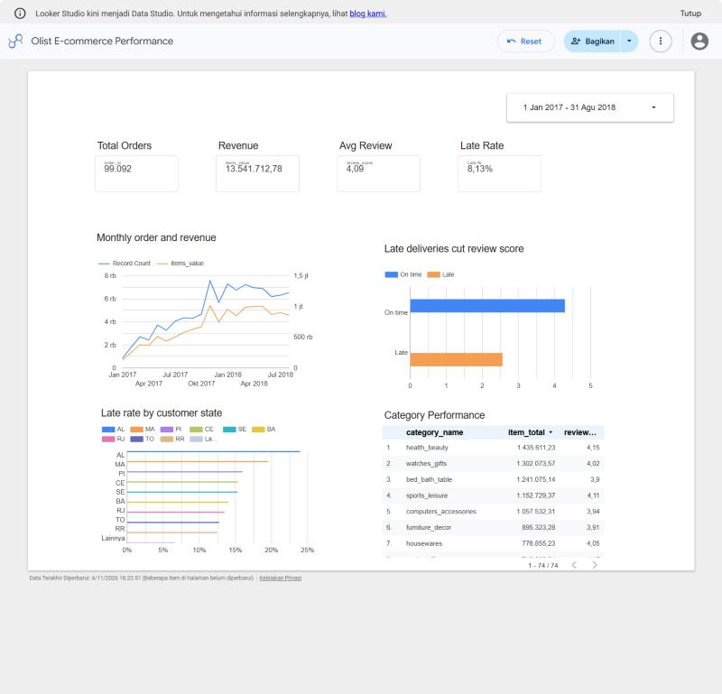
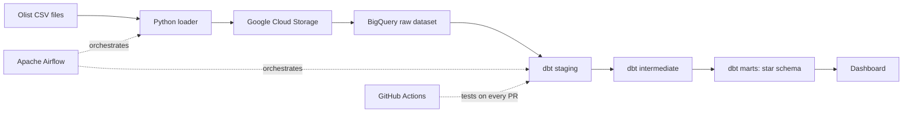

# E-commerce Data Warehouse

An end-to-end batch ELT pipeline that turns raw e-commerce data into a tested star schema in BigQuery, orchestrated with Apache Airflow and modeled with dbt.

**[View the live dashboard](https://datastudio.google.com/s/pjhwMohMZ4o)**



## Business goal

Give analysts one trusted source for sales, delivery performance and customer satisfaction, so questions such as "which categories lose the most money to late deliveries?" do not need one-off queries on raw files.

## Architecture



## Tech stack

| Area | Tools |
|---|---|
| Orchestration | Apache Airflow, Docker Compose |
| Storage | Google Cloud Storage, BigQuery |
| Transformation | dbt, SQL |
| Data quality | dbt tests, dbt_utils |
| CI | GitHub Actions, DuckDB |
| Dashboard | Data Studio (formerly Looker Studio) |

## Data model

| Table | Grain |
|---|---|
| `fct_order_items` | One row per item in an order |
| `fct_orders` | One row per order |
| `dim_customers` | One row per real customer |
| `dim_products` | One row per product |
| `dim_sellers` | One row per seller |
| `dim_date` | One row per calendar day |
| `rpt_orders` | Flat dashboard table, one row per order |
| `rpt_order_items` | Flat dashboard table, one row per item in an order |

## Design decisions

- **Raw tables are all strings.** Types are cast in dbt staging, so a bad value fails a visible model rather than the load job.
- **`dim_customers` uses `customer_unique_id`.** The source creates a new `customer_id` for each order, so using it would count repeat buyers as new customers.
- **Reviews are reduced to one per order** before joining, because some orders have several reviews and would otherwise be double counted.
- **Fact tables are partitioned by month and clustered** on common filters to reduce the bytes BigQuery scans.
- **No service account keys.** The pipeline impersonates a least-privilege service account through Application Default Credentials, so no long-lived key is created.
- **CI runs on DuckDB with sample data,** so every pull request runs the models and tests with no cloud credentials or cost.

## Run it locally

1. Download the [Olist dataset](https://www.kaggle.com/datasets/olistbr/brazilian-ecommerce) and put the CSV files in `data/`.
2. Create a GCS bucket and a service account with BigQuery and Storage access. Run `gcloud auth application-default login --impersonate-service-account=SERVICE_ACCOUNT_EMAIL`, then copy `application_default_credentials.json` into `keys/`.
3. Copy `.env.example` to `.env` and fill in your values.
4. Start Airflow:

   ```bash
   docker compose up --build -d
   ```

5. Open http://localhost:8080 (local login `admin` / `admin`), then enable and trigger the `olist_warehouse` DAG.

## Test without GCP

```bash
pip install "dbt-core~=1.12.0" dbt-duckdb duckdb
python scripts/load_sample_duckdb.py
cd dbt
dbt deps --profiles-dir .
dbt build --target ci --profiles-dir .
```

## Results

The full run loads about 550,000 raw rows across 8 tables and passes 66 of 67 dbt tests, with 1 warning explained below.

| Metric | Value |
|---|---|
| Orders | 99,441 |
| Order items | 112,650 |
| Unique customers | 96,096 |
| Customers with more than one order | 3.1% |
| Orders delivered late | 8.1% |
| Average review score, delivered on time | 4.29 |
| Average review score, delivered late | 2.57 |

Late delivery is strongly linked to lower review scores, which makes delivery performance a clear area for the business to investigate.

## Challenges

- **Service account keys were blocked** by an organization policy, so the pipeline moved to keyless impersonation through Application Default Credentials.
- **Payment totals do not always match order totals.** 246 delivered orders differ by more than 1 BRL. This is reported as a warning so it stays visible without stopping the pipeline.
